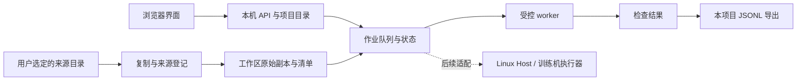

# 数据管线工作台：跨平台架构与验收设计

日期：2026-10-26。范围：单人、单机器人，阶段按钮为主，可选择串联。本文把长期产品方案收敛到一个可落地的首版，并单独说明 Windows 的路径和进程问题。具体测试结果以同版本的测试记录、CI 和运行日志为准；设计目标不等于已经通过验收。

## 1. 首版交付什么

用户先设置任务、目标本体和策略，再登记本机已有数据，确认来源、任务、标签、许可与源本体。数据复制进入工作区后，可以检查原始回合，查看问题，按按钮导出本项目定义的 JSONL 数据契约，或串联“检查 → 导出”。每次运行保留输入、配置、状态、日志与产物。

首版优先验证数据工作流。**本项目的 JSONL 导出不是官方 LeRobot 数据集，也不意味着可以直接训练所有策略。** 宇树官方转换器、ACT/Diffusion/openpi/OpenVLA 的训练后端、真机服务启动、仿真与部署，应分别通过适配器接入和验收。尚未接入的阶段显示缺少什么，不以空按钮或假成功代替。

| 层次 | 首版方案 | 后续扩展边界 |
| --- | --- | --- |
| 使用界面 | 浏览器界面，应用服务只监听本机回环地址 | 桌面封装属于分发优化，不改变数据契约 |
| 项目与资产 | SQLite 保存项目、来源、标签与作业；文件保存原始副本和产物 | 后续接对象存储；来源登记与文件持有范围继续分开 |
| 数据检查 | 明确支持的原始 JSON 格式、字段与数值检查 | 逐一添加格式读取器、图像解码、时间与标定检查 |
| 执行作业 | 单 worker，受控参数列表启动 Python 子进程 | GPU/远程 Linux 执行器通过任务协议接入 |
| 本体与策略 | 已选配置和能力缺项可见 | 每个组合单独验收，不能仅凭维数相同视为兼容 |

界面运行在 Windows，不要求机器人软件也运行在 Windows。合理的真实部署是“Windows/Mac 操作界面 + Linux Host/训练机 + 机器人机载 Linux”，其中 Host、机内 PC2 与训练机仍是不同执行目标。跨平台的是工作台和作业协议；厂商 SDK、驱动、XR 服务和 GPU 训练环境需要各自的平台支持清单。

## 2. 数据和执行边界



默认启动不导入示例、不下载数据、不启动机器人、不执行训练。教学数据通过明确按钮创建，资产、日志和产物保留合成标识。质检通过仅表示所实现规则通过，不能证明硬件同步、任务成功、控制安全或采购合格。

工作区可采用以下逻辑结构，具体目录名由实现统一管理：

```text
workspace/
  catalog.sqlite3
  assets/<generated-id>/      原始数据副本与清单
  jobs/<generated-id>/        日志、结果及导出
```

显示名称、中文标签和任务描述属于元数据，不直接用作目录名。生成的目录 ID 使用 Windows、macOS、Linux 都接受的短字符。资产与作业之间通过 ID 和哈希关联，用户移动整个工作区后不应修改每条内部路径。源目录可作为历史来源记录；后续处理只依赖受管理副本。

## 3. 路径规则，尤其是 Windows

### 3.1 三种路径不能混用

| 路径类型 | 规则 | 例子 |
| --- | --- | --- |
| 用户选择的本机来源 | 按**服务所在操作系统**解释；允许该系统的绝对路径；界面说明这是服务机器的目录 | Windows 的 `D:\robot data\搬箱`；Mac 的 `/Users/name/robot data` |
| 工作区中的文件引用 | 统一序列化为相对 POSIX 路径；读取时在工作区根目录下解析并校验 | `assets/a123/episode_0001/data.json` |
| API/网页链接 | URL 编码，不把盘符或本机绝对路径拼入链接 | `/api/artifacts/job123/result.json` |

Linux 上看到 `C:\data` 不能自动映射成 Windows 磁盘。浏览器在另一台机器上打开工作台时，来源路径也不是浏览器本机文件系统。后续若要通过浏览器上传目录，应增加独立上传协议和逐文件相对路径校验，不能假装一个目录选择框已经完成传输。

### 3.2 必须处理的具体问题

| 问题 | 实现约束 | 验证方式 |
| --- | --- | --- |
| 中文、空格、括号、`&` | 使用 `Path` 和参数数组，不拼接 shell 命令；所有文本显式 UTF-8 | 工作区和来源同时包含中文、空格、特殊字符，完整运行 |
| `/` 与 `\` | 受管理数据引用使用 `/`；同时检查 Windows 和 POSIX 的绝对路径/越界语义 | 同一测试在三系统验证 `../x`、`..\x`、盘符、UNC 和设备路径 |
| `C:foo` 与 `C:\foo` | 前者是盘符相对路径，不当作普通相对文件名 | 受管理引用明确拒绝带盘符路径 |
| 保留名和非法字符 | 生成 ID 避免 `CON`、`NUL`、`COM1`、冒号、尾随点/空格等 | 来源存在不可移植名字时拒绝或明确提示，不静默重命名 |
| 大小写冲突 | 不假设文件系统大小写敏感；导入检查便携路径冲突 | `A.jpg` 和 `a.jpg` 在允许创建它们的系统中测试 |
| 路径过长 | 短 ID、浅层作业目录；长来源路径失败时给出路径与缩短目录建议 | Windows 实测长路径，不能以注册表默认开启长路径为前提 |
| 符号链接、junction | 导入与结果下载禁止链接逃出受管理根目录；检测到不支持的链接类型则拒绝 | 各系统权限允许时创建链接；Windows 创建权限不足时记录跳过原因 |
| 当前工作目录变化 | 资源按包位置读取；作业明确 `cwd`，解释器用 `sys.executable` | 从另一个空目录启动已安装包并跑作业 |
| 复制中断、磁盘满、重复导入 | 临时导入完成后才登记成功；原始目录只读；限制大小和文件数 | 注入失败，检查无“成功资产”和无残留不完整产物 |
| 来源被修改 | 哈希清单绑定复制结果；导出前校验输入一致性 | 检查后修改副本，导出必须失败或重新检查 |

对内部路径只调用 `Path.resolve()` 还不够：在 macOS/Linux 上，反斜杠不是目录分隔符。必须先识别并拒绝不允许的跨平台路径语法，再做根目录包含性与实际文件类型检查。不能用字符串 `startswith(root)` 判断目录包含关系。

## 4. 环境、子进程和取消

### 4.1 安装与启动

工作台基础服务采用 Python 标准库，避免为了打开界面就安装 MuJoCo、CUDA、Torch、PyArrow 或厂商 SDK。实验依赖、训练环境和机器人环境分离。安装包必须包含静态 HTML/CSS/JS，并在干净虚拟环境中验证，不能依赖当前仓库目录恰好存在。

通用原则是 `python -m pip`、`python -m robot_pipeline.workbench`，其中 `python` 代表用户选定的解释器。Windows 可用 `py -3.11` 创建虚拟环境，但工作台后台使用当前环境的 `sys.executable`，不会假设 `.venv/bin/python`。无需激活脚本也可直接运行 `.venv\Scripts\python.exe`，从而避免 PowerShell 执行策略阻止 `Activate.ps1`。

当前本机的 `requirements-lock.txt` 是实验环境快照，不是三系统安装成功的证据。训练框架、显卡后端、Python 版本和平台 wheel 的组合应由具体适配器声明并测试。CPU 界面通过不等于 CUDA、NPU 或机器人 SDK 可用。

### 4.2 进程约定

- 用 `Popen([sys.executable, '-m', module, ...], shell=False, cwd=..., env=...)`，不使用 `source`、`bash -c`、`cmd /c` 或字符串拼命令来执行用户输入。
- 运行参数保存为数组；日志中的命令仅供显示，不能再拿显示字符串执行。路径含空格无需手工加引号到数组元素中。
- worker 只运行预先登记的阶段和模块。浏览器请求不能直接指定任意可执行文件或 Python 模块。
- 子进程与日志使用 UTF-8，基础服务不依赖中文 Windows 的默认代码页。必要时为 Python worker 设置 `PYTHONUTF8=1`、`PYTHONIOENCODING=utf-8`。
- 单机默认一个作业并行；数值线程数保守设为 1。训练、渲染前由对应执行器检查负载和可用资源；没有温度读数时只记录热状态可用性。
- 取消先改变作业状态并通知本任务持有的进程句柄，再回收进程。不得按名字终止所有 `python`、`node` 或 `ffmpeg`。
- POSIX 进程组与 Windows 进程组、控制台信号并不等价。首版只验收自有直接 worker；允许插件创建孙进程前，必须补上 Windows Job Object 或等价的子树生命周期管理和验收。
- 服务启动时把上次残留的 `running` 作业标记为中断，不能假装自动成功。失败、取消和中断不会推进自动链路，也不会覆盖已有成功产物。

## 5. 本地服务的边界

首版为单用户本机工具，服务只监听 `127.0.0.1`。写请求要求同源和会话 token；校验 `Host`，不给任意跨域网页读取会话数据；不启用宽泛 CORS。静态和产物路由分别限制根目录、拒绝路径逃逸。项目目录和数据库不作为静态目录暴露。

这套本机边界不等于多人部署方案。若未来开放局域网，需要认证、授权、TLS、上传隔离、审计和并发控制，并换用适合服务部署的 HTTP 运行方式。Python 官方明确指出 `http.server` 不适合生产级公共服务。

## 6. 现有代码检查结果

以下是本次读取现有文件时发现的问题，不能被新工作台的跨平台 CI 自动覆盖：

| 文件/范围 | 已发现情况 | 处理方向 |
| --- | --- | --- |
| `robot_pipeline/core.py` 的旧转换规划 | 原先示例缓存目录为 `/tmp/...`；命令首项写 `python` | 本版已改用平台临时目录、独立 UUID 缓存与 `sys.executable`；执行官方转换前仍须选择完整上游环境的解释器 |
| `robot_pipeline/core.py` 等旧 CLI | 部分 `read_text/write_text` 未显式指定编码 | 逐步补齐 UTF-8；跨平台测试覆盖中文元数据 |
| `robot_pipeline/render.py` | 默认字体固定为 macOS `STHeiti`；依赖仓库 `assets` 与 `evidence` | 渲染作为实验适配器单独配置资产、字体与 OpenGL 后端；暂不纳入基础工作台支持承诺 |
| `scripts/*report*` 和文档构建 | 存在 macOS 用户目录、Codex runtime 和 `/bin/zsh` | 定位为当前报告制作工具；基础安装不能调用这些脚本。后续另做可配置工具链 |
| 旧 README 命令 | `.venv/bin/python` 与 POSIX 环境变量写法 | 新工作台手册提供 Windows PowerShell 和 macOS/Linux 命令，优先直接调用解释器 |
| `requirements*.txt` | 当前实验依赖的精确版本 | 工作台零运行依赖；实验依赖单独选择和验证，不把本机快照称为通用锁文件 |

## 7. 验收矩阵

核心 CI 应在 `windows-latest`、`macos-latest`、`ubuntu-latest` 原生 runner 上执行同一组 Python 测试，并构建、安装 wheel 后从仓库外启动。测试工作区与真实工作区隔离；测试不连接机器人、不下载大数据、不执行训练。

| 级别 | 必须验证 | 证据 |
| --- | --- | --- |
| 单元与边界测试 | 路径解析、非法引用、中文编码、校验逻辑、作业状态 | 每系统测试名称、通过/失败/跳过数量 |
| API 集成 | 项目保存、显式示例、目录导入、质检、导出、失败停止、日志、重启 | HTTP 状态与结果 JSON、产物哈希 |
| 打包安装 | wheel 包含静态文件；干净环境无实验依赖启动 | 已安装 wheel 的启动和首页请求 |
| 真实 worker | 空格中文工作区内子进程成功、取消/失败不推进下游 | 作业状态和日志，无本任务残留进程 |
| 界面检查 | 空状态、示例导入、失败提示、窄窗口、键盘焦点 | 浏览器截图和操作记录 |
| 硬件/训练接入 | 本体契约、服务健康、控制范围、真实数据和策略验收 | 独立设备/框架版本与现场记录 |

**状态口径：** 仅在本机测试通过，写“macOS 本机通过”；CI 编写完成但未运行，写“已配置，待运行”；三系统 CI 通过，写明链接和 commit。路径纯语义测试不能替代 Windows 文件系统实测，Linux 通过也不能推断 Windows PowerPoint、Vision Pro 或真机 SDK 通过。

首版可接受的闭环是：新建空工作区 → 设置任务 → 手动导入合成样例或自有支持格式 → 检查问题 → 成功导出本项目 JSONL → 重启仍可查看 → 整个工作区复制到中文含空格目录仍可执行。真实采集、官方转换、训练、仿真和部署分别列入后续验收，不混入该闭环的完成定义。

## 8. 原始权威资料

- [Python `pathlib`：本机路径与纯路径语义](https://docs.python.org/3/library/pathlib.html)
- [Python `os.path`：Windows/POSIX 路径与盘符相对路径](https://docs.python.org/3/library/os.path.html)
- [Python `subprocess`：参数数组、环境、cwd 与进程控制](https://docs.python.org/3/library/subprocess.html)
- [Microsoft：Windows 文件、目录与命名空间规则](https://learn.microsoft.com/en-us/windows/win32/fileio/naming-a-file)
- [Python `http.server`：适用范围与安全限制](https://docs.python.org/3/library/http.server.html)
- [Python 隔离模式 `-I`：忽略 `PYTHON*` 环境变量](https://docs.python.org/3/using/cmdline.html#cmdoption-I)
- [Python 文本流 `reconfigure`：显式修改输出编码](https://docs.python.org/3/library/io.html#io.TextIOWrapper.reconfigure)

以上资料用于解释平台规则。具体软件实现与已验证范围以项目同版本代码和验收记录为准。

## 9. 本轮 Windows 原生 CI 发现的实际问题

第一次原生矩阵运行 [40249899652](https://github.com/fengjikui/robot-data-pipeline/actions/runs/40249899652)（commit `06381aa`）中，Windows Python 3.11 和 3.14 都在“从仓库外安装 wheel 后测试”阶段失败。具体失败是隔离模式 `python -I -m robot_pipeline.workbench --help` 输出中文帮助时，重定向 stdout 使用 cp1252，触发 `UnicodeEncodeError`。wheel 安装本身已成功；不能把它误判为中文路径或长路径错误。

根因是 `-I` 会忽略 `PYTHONUTF8/PYTHONIOENCODING`，仅在 CI 或父进程设置这些环境变量不足以保证 CLI 输出。修复采用在工作台 CLI 入口、argparse 输出之前显式设置 stdout/stderr UTF-8。保留原来的隔离安装测试，并新增两个子进程回归：强制 cp1252 严格编码，再分别验证中文帮助和中文参数错误输出。修复后的最终原生矩阵结果由总验收记录报告；本段记录首次发现与处理方式，不代替最终通过证据。
