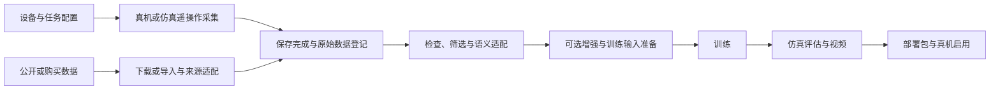

# 具身智能数据管线工作台 产品定位与结论

2026-10-26方案更新：当前v0.1.2仅完成本地导入、结构质检、自有JSONL与记录等基础能力。后续总体方向以[整体方案与分期](10_整体方案与产品价值_2026-10-26.md)、[交互详细设计](11_交互逻辑与界面设计说明.md)及[开发验收映射](12_开发工作包与验收映射.md)为本轮补充；下文未实现功能仍为规划。

更新日期：2026 年 10 月 26 日。本文按用户澄清定义产品，已补充外部数据资产库和有限本体/配方范围，是后续实现的起点。当前已有基础数据准备原型；以下完整链路页面、按钮与适配器仍为拟建设能力，实际完成度按上方v0.1.2说明区分。

## 我们究竟要做什么

建设一个带界面的具身智能数据管线工作台。用户在其中选择任务、设备和数据来源，准备并启动跨设备的采集服务，管理每次采集的回合，再逐步完成检查、筛选、可选增强、转换、训练、仿真评估和真机部署。后台调用并管理厂商工具和训练框架，界面把原本分散在多个终端、设备和目录中的步骤串成可观察、可重试的流程。

产品的主要价值，是让操作者清楚知道“现在能做什么、缺什么、数据到了哪里、下一步会发生什么”，并减少反复登录设备、输命令、找文件和对齐配置的工作。自行采集与外部数据入库、检索和复用都是核心能力；数据推荐可以辅助选型。此前的 CLI、关节预测和视频属于局部技术验证，不能当作已经建成这个工作台。

用户已确认首期两项取舍：**单人操作一台机器人；每个阶段有独立按钮，可选择自动串联。** 训练机、Host、机器人机载计算单元可以是多台计算设备，“单机器人”不等于“单电脑”。

实际支持范围进一步收敛为少量已选本体与训练配方，先验收必要组合。整理数据与使用数据是两种工作角色，可由同一人承担。新来源、训练方法和本体通过预留接口逐项扩展。

采集侧也保留跨本体接入方向：上层会话/录制操作尽量一致，下层封装操作者输入、动作映射、设备控制、视频和记录后端。先接 G1，后按采购或自研设备逐项适配，见初步调研；这不自动解决已有示范或模型的跨本体迁移。

## 从用户角度看完整流程

第一次使用：创建设备档案 → 配好连接与环境 → 核对相机、遥操作设备与控制模式 → 保存成模板。

以后自己采集：选择模板 → 准备采集环境 → 启动遥操作 → 新建回合并录制 → 结束并保存 → 检查与筛选 → 按需增强 → 转换为训练输入 → 启动训练 → 仿真评估与看视频 → 生成部署包 → 在设备上启用并观察效果。

整理外来数据：登记网站/交付来源 → 读取元数据 → 确认分类和说明 → 按需下载或导入目录 → 检查并登记到资产库。来源条目、实际持有范围、任务数据视图与适用性证据分别保存。

训练时使用外来数据：选择任务、本体、训练配方与用途 → 在资产库筛候选并预览 → 查看匹配和缺项 → 保存回合视图 → 执行已支持适配并读取验收 → 训练与评估。再次使用可复用已保存条件与产物。单纯视频或缺少动作语义的数据，不应自动获得“可以训练当前机器人策略”的标记。

“自动串联”表示用户选好规则后，把已满足前置条件的阶段依次执行；不是无条件跳过失败、人工标注、机器人现场准备或不兼容检查。默认自动链路最多运行到仿真评估，真机启用保留为明确的设备操作。

图中的阶段可独立操作；已经满足训练输入的来源可以跳过重新打包。训练时增强由训练配置执行。跨本体迁移如未具备，流程停在语义适配并显示缺项。

## 最重要的区分

| 用户改变什么 | 通常需要改变什么 | 通常可以继续复用什么 |
| --- | --- | --- |
| 同一 G1、同一配置，换一个搬箱任务 | 任务说明、采集场景、质量规则、训练与评估任务配置 | 页面、作业状态、采集管理、基本 SDK 连接 |
| 同一机器人，换相机或手部 | 传感器配置、标定、观察/动作契约；必要时改手部适配器与模型输入输出 | 大部分工作流与数据管理 |
| 同一目标机器人，换成公开或购买数据 | 来源登记、下载、读取器、字段/单位/时间处理；视源数据决定是否需要动作迁移 | 任务和目标设备档案、作业管理、可兼容的训练/评估后端 |
| G1 换宇树另一型号 | 机器人档案；检查遥操作控制类、关节和手型、数据 schema、仿真及部署支持，缺失处补适配器 | 同厂商部分通信与采集模块，以及通用界面与编排 |
| 换智元或银河通用本体 | 厂商接口、服务编排、遥操作与记录适配、模型资产、控制器与设备验收 | 上层工作台、作业生命周期、通用检查、数据来源与结果管理 |
| 换固定机械臂 | 机械臂控制与夹爪、外部相机、动作定义、仿真与场景；不再需要行走控制 | 采集到训练的共同流程 |

因此不能设计成“所有机器人统一成 28 维，换一个 IP 就能使用”。统一的是流程、状态和有明确语义的数据接口；具体关节、控制模式与可用能力由设备适配层提供。

## 这次调研得到的边界

- 宇树 G1 是首个拟接通的目标；其他厂家本轮只形成接入方案，不声称已经兼容。
- 智元 A2 的 AimDK、智元 G2 的公开数据和 GenieSim 是不同材料，不能把它们拼成已验证的单一真机链路。
- 银河通用 Galbot 与银河动力 Galaxea 是不同公司。银河通用还发布了面向**宇树 G1**的 OpenWBT；软件发布方不等于数据/策略的目标本体。
- 同叫 G1 的机器人可能来自不同厂家，设备标识必须带厂家和配置。
- 公开文档能证明接口存在，不证明我们已拿到 SDK、场景、数据导出协议或所有功能权限；未知条件要显示为“待核实”。具体证据与版本见调研文档。

## 为什么工作量不能只按按钮数判断

同一套已经安装好的 G1 工具，加上少量可观察的启动/退出/录制接口，做一个可靠的入口是可控的工程任务。但“跨机器启动 + 保证数据保存 + 失败恢复 + 多来源适配 + 训练/仿真/部署”需要多层接入；跨本体的动作迁移还可能包含新的算法和数据工作。

建议先完成一个**窄而完整的 G1 链路**，每一步都能单独执行、看结果和失败恢复，再沿着已划定的适配边界扩展。不要先建设一个只能点击的多厂家大界面，也不要把第一个启动按钮称为“全管线已经打通”。

## 阅读顺序

1. [产品需求说明](01_产品需求说明.md)：产品功能、用户故事、最小完整范围与分期。
2. [G1 一键采集与服务编排](02_G1一键采集与服务编排.md)：一键启动具体要组织哪些设备和程序。
3. [三家厂商与更换本体适配调研](03_三家厂商与更换本体适配调研.md)：宇树、智元、银河通用及机械臂的变化矩阵。
4. [数据来源与转换层次](04_数据来源与转换层次.md)：自己采集、开源和购买数据为何要走不同入口。
5. [页面按钮与异常流程](05_页面按钮与异常流程.md)：用户实际看到什么、每个按钮何时可用。
6. [调研来源与证据](06_调研来源与证据.md)：一手资料、固定版本、已证实与未证实项。
7. [外部数据资产库与使用流程](07_外部数据资产库与使用流程.md)：整理者与训练使用者的流程、字段/枚举、标签、适用性检查和有限支持清单。
8. [跨本体遥操作与采集接口初步调研](08_跨本体遥操作与采集接口初步调研.md)：保持采集操作一致，按具体设备扩展输入、控制、视频与记录后端。
9. [任务驱动的数据选型与采购验收](09_任务驱动的数据选型与采购验收.md)：从固定任务和目标本体出发，整理现成数据与委托采集的需求、试用、转换和分层验收。

旧版 Word 是上一轮的 G1 技术参考，本轮以这些 Markdown 为产品需求主文档。需求稳定后再统一排版导出。

本轮补充阅读：

10. [整体方案、用户问题与四阶段路线](10_整体方案与产品价值_2026-10-26.md)
11. [详细交互与界面设计](11_交互逻辑与界面设计说明.md)
12. [开发工作包及验收映射](12_开发工作包与验收映射.md)
