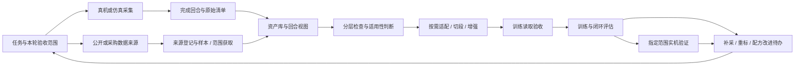

# 数据管线工作台：整体方案、产品价值与分期

更新：2026-10-26。用于今晚报告及后续产品开发。当前实现基线为工作台 v0.1.2，规划内容均不代表已经接通真机、训练或部署。

## 1. 我们要帮助使用者完成什么

使用者带着一个训练目标进入工作台，选择少量已支持的本体和训练配方，取得合适的数据，检查与处理后实际训练、评价，再将结果带回下一轮数据准备。平台应始终回答四个问题：**我现在有什么、这一步为什么能做或不能做、完成后得到什么、失败后从哪里继续。**

首期服务一人、一台机器人。G1 是第一个接入对象；首个模型配方建议从一条可核实的模仿学习路线开始，再逐项增加 Diffusion、openpi 等。准确本体、手型、相机、运行环境与首个配方要现场核实，不以“43 自由度”推断完整控制契约。

搬箱总目标包括抓取、负载搬运、行走和放置。首轮可以先验收受限抓放的数据闭环，但项目必须分别记录总目标与本轮验收范围。双臂数据、固定机身仿真或训练损失不能证明完整搬箱已经完成。

## 2. 当前怎样做，平台具体解决什么

下表的现状依据官方工具步骤和本仓库实测整理。人工成本与容易出错的位置属于工程分析，尚未进行团队用户计时，不能引用为行业普遍发生率。[S1–S8]

| 环节 | 现有做法与已有能力 | 使用者需要承担的交接 | 我们拟提供的操作 | 验证价值的方法 |
| --- | --- | --- | --- | --- |
| 明确任务 | 研究人员选择任务、机器人、算法，再各自写配置 | 总目标、数据任务、控制范围容易混在一起 | 任务项目区分总目标、本轮范围、成功判据；复用设备与配方档案 | 换数据后目标仍清楚，来源任务不被覆盖 |
| 真机采集 | PC2 相机、Host 遥操作/记录、Vision Pro XR，以及厂商基础服务协同 | 找对设备、环境、地址、启动顺序；判断真实就绪和保存完成 | 保存设备档案，逐项只读预检，组织服务，显示人工待办与录制状态 | 重复会话不再手工拉起已接入服务；中断能定位到设备与阶段 |
| 仿真采集 | 在匹配的仿真任务中遥操作/生成回合 | 环境、控制器、传感器与真机可能不同 | 独立仿真采集配置，复用回合登记和质检流程 | 不把仿真状态误发到真机，不把回放当闭环评价 |
| 外部获取 | 浏览 Hub/厂商交付清单，下载子集或从硬盘复制 | 反复找网址、目录、版本、用途和实际持有范围 | 先登记来源，再取样/选范围；自动提取能读取的字段，人工确认关键项 | 已登记与已入库分开；第二次使用可直接找回已持有数据 |
| 分类与选数 | 阅读 dataset card，比较任务、本体、模态和动作 | 标签相关不代表适合当前用途，格式名称容易被当成兼容性结论 | 任务内选候选，查看具体差异，保存回合视图与适用性证据 | 能说明可直接读取、需已知适配、缺材料或需新适配的原因 |
| 质量检查 | 脚本统计、人工看视频/曲线、对照字段 | 日志、帧号、相机与关节信息分散；结构通过后仍可能存在时序或任务问题 | 分层检查和同一时间轴预览；问题定位到回合/帧，保留人工结论 | 发现问题能回到原始记录，排除坏回合后可复用其余输入 |
| 增强与整理 | 配置视觉变换、切段、重渲染或重新仿真 | 母回合、划分、增强参数容易丢失，增强不一定补足动作语义 | 先预览再执行；母子关系与固定划分一并保存，昂贵步骤按需运行 | 母回合及其派生不跨训练/测试集合，不覆盖原件 |
| 转换与适配 | 运行转换器，再在训练配方中配置字段、归一化和时间窗 | 同一容器仍可能有本体、动作、相机和版本差异 | 预览输入输出、列出变换/损失，运行固定适配模板，再做实际读取验收 | 不把 JSONL 或 LeRobot 容器名称等同于所有模型均可训练 |
| 训练 | 选数据、配置执行机和环境，运行训练并保存模型 | 配置、日志、数据划分、统计量和权重容易脱节 | 配方模板与执行机预检，显示实际预算和产物，绑定数据视图与配置快照 | 结果可追溯并能复跑；重试不从头处理已有成功产物 |
| 仿真与部署 | 配置闭环任务评价、推理运行时和控制接口 | 离线 loss、回放、仿真与实机成功容易混用 | 分开展示读取、训练、闭环评估和实机验证证据；部署匹配控制配置 | 实际成功率、失败原因、视频与模型绑定，受限验收不越界 |
| 迭代与交接 | 人工整理日志、截图、笔记与数据目录 | 不知道失败来自数据、配置、模型还是环境，也难复用他人结果 | 从评估问题建立补采/重标/适配待办，保留执行位置、输入输出与日志 | 接手者能定位问题并从成功节点继续，而非重做整条链路 |

## 3. 市场和开源现状：先复用，再做差异部分

现有生态已经覆盖不少单项能力，不能以“大家都只能敲命令”概括现状。

| 已有工具 | 官方已经提供什么 | 对本项目的启发和边界 |
| --- | --- | --- |
| Unitree xr_teleoperate / unitree_lerobot | G1 等设备的 XR 遥操作、记录和转换/训练相关工具 | 复用厂商控制与记录能力，补多设备编排、状态核实和工作流交接；固定版本验证 |
| LeRobot / LeLab | 数据与硬件抽象；LeLab 提供配置、遥操作、采集、训练与推理图形流程，当前文档注明 LeLab 仅支持 SO-ARM101 | 原型和接口应参考成熟做法；G1 与外部资产/采购流程的差异仍需实际比较，不能宣称竞品完全没有这些能力 |
| Hugging Face Hub | dataset card 元数据、版本下载、文件筛选和缓存 | 复用来源解析与下载库，不自行重写大规模互联网搜索/传输系统 |
| Isaac Lab Mimic | 从示范出发的仿真数据生成与模仿学习流程 | 作为特定场景后端候选，需要任务、控制和仿真资产，不能对任意真机数据直接“扩增” |
| openpi 等训练仓库 | 自有数据接入、预处理、归一化及训练/推理配方 | 包装明确的配方与环境，保留各后端差异，不设计一套万能转换参数 |

[S1–S8] 的公开能力是事实依据。**优先构建一个面向我们实际 G1 场景、可解释且可恢复的工作流**是本项目的产品选择，不是已测得的独占优势。开发前对可复用组件做小规模接入试验，合适就直接使用。

## 4. 理想方案：一个任务，两类入口，共同的执行记录

图中以首个离线示范学习配方展示主线。以后接入在线强化学习时，需要环境、奖励、重置与在线采样等不同分支；示范可以单独用于预训练，不能强迫所有策略都先经过同一个离线转换器。逐策略边界见[转换与策略适配](../report/12_采集转换训练配置与策略适配.md)。

图中表示理想目标。外部数据允许从不同层级接入：原始录包先解包/分段；已整理轨迹先核对语义；已有训练格式先验收读取器和目标配方。无需重复的处理可跳过，但应记录已检查的依据。整个流程中的人工节点、失败分支和后端能力在界面中真实显示。

### 五项用户价值

1. **少记配置。** 首次建立档案，重复采集、转换和训练使用已验证模板，关键变化再检查。
2. **少找数据。** 来源、版本、持有范围、任务标签和历史适配结果在库内可查，少量必要信息导入一次后复用。
3. **少做无效尝试。** 在下载整库、长时间转换或训练前，先看缺项、样本和配方读取结果。
4. **失败后能继续。** 看到问题位置、已成功产物与可执行恢复动作，尽量只重试失败阶段。
5. **结果能解释。** 找得到一次评价对应的数据选择、变换、模型、场景与配置，并把问题变成下一次采集需求。

这些价值通过下文验收衡量，暂不承诺节省百分比。目录选择、预填、进度提示等是实现上述目标的交互细节，也需要与阶段闭环一并验收。

## 5. 四个阶段，逐个交付完整结果

沿用原需求的 M0–M4 编号。M0 是接口盘点与基础原型，当前只完成其中一部分；后续分四个交付阶段。排期以设备、环境、实际开发投入核实后再估，不按未调查的人力编造完成日期。

| 阶段 | 用户能完成的闭环 | 必须交付 | 阶段验收与依赖 |
| --- | --- | --- | --- |
| 当前基础原型 / M0 部分 | 本地目录入库、结构检查、自有 JSONL 导出、查看记录 | v0.1.2、路径选择、来源标签、文件清单、日志和取消 | 已有自动测试与浏览器证据；真机采集、训练格式、训练/部署仍未接入；大数据规模不在当前128 MiB限制内 |
| M1 采集与入库 | 通过图形流程采集并可靠保存，或登记/导入外部样本，然后查找与检查 | G1 设备档案、只读预检、Host桥接、服务编排、录制状态机、回合预览、资产基础编辑与来源/范围登记 | 模拟适配器先测断连/超时，再实机连续3次会话、每次10个回合；保存完成后才入库；二次使用无需重填模板。硬件前可开发软件链路 |
| M2 处理、训练与仿真 | 选定数据视图，经固定配方准备输入，真实训练并闭环评估，能复用与回溯 | M2a：有限来源获取、视图/分层检查；M2b：官方格式适配、划分/统计与读取；M2c：一个训练后端与匹配仿真任务。增强先按需接训练时视觉变换 | 训练读取验收、真实训练与匹配任务闭环均留证；母子划分无泄漏，失败阶段可单独重试。先接一个配方，不同时追求所有策略 |
| M3 受限部署与数据回流 | 在定义的动作范围内把评估后的模型部署到目标 G1，回收失败样本形成补采计划 | 部署包、模型/归一化/动作解释器绑定、设备匹配检查、正常退出/回退、失败回合回流 | 先验证受限抓放，再单独评估负载与行走；仿真可用不直接放行真机。整条链路验收后才称首个完整 G1 管线 |
| M4 有限范围扩展 | 同一工作流复用第二个来源、第二个配方或新增本体 | 来源读取、采集、训练/评估、部署适配接口与兼容矩阵；按采购计划接入 | 一次新增一个具体组合，以相同用户任务验证复用；接口存在不等于新厂商接入成功 |

M1 同时包含外部数据基础整理；M2 继续增强外部数据获取与复用。外部数据不是必须等全部真机工作完成才开始的独立大工程。报告叙事仍按“完整自采链路，再讲外部接入，再讲平台”组织。

### 下一轮开发顺序

| 优先级 | 工作包 | 可 review 的完成标准 |
| --- | --- | --- |
| 立即修正 | 来源任务不复制目标任务、结构检查范围提示、输入约束统一、切换时隐藏旧结果 | 目标/来源语义分开，错误不会误展示到其他资产；保留用户表单 |
| 第一条主线 | 设备档案与模拟采集桥、会话状态/文件完成事件 | 无硬件可演练成功、保存失败、断连与重试；所有模拟结果明确标记 |
| 接真机 | PC2图像服务、Host IPC、XR待办及完成回合入库 | 通过真实图像/状态/录制/落盘验证，控制启用与只读检查分开 |
| 第二条并行基础 | 外部来源登记、编辑、样本清单、任务筛选与回合视图 | 同一份外部样本第二次查找与选择可复用，无需重新复制与填写所有字段 |
| 接可训练后端 | 固定转换器与一个训练读取器，再接训练/评价 | 配方/本体改变时列出需重做的检查；JSONL导出不再被误认为训练完成 |

## 6. 如何衡量是否好用

以下是**拟验收目标**，尚无使用者计时或改进比例。先记录旧流程基线，再在相同设备、网络和数据范围上对比。

| 测量任务 | 测量内容 | 初拟验收 |
| --- | --- | --- |
| 重复采集 | 准备耗时、终端次数、非必要重复输入、失败定位耗时 | 一次初始化后3次会话均可用阶段按钮完成；不要求重复手工启动已接入服务 |
| 查找已入库样本 | 能否找对来源/版本/范围，并建立数据视图 | 5名试用者至少4名在无口头提示下完成；记录中位用时再定优化目标 |
| 发现不适配数据 | 能否说出阻断原因与下一步 | 对预设的动作语义/缺相机样本，不出现错误放行；有材料补齐或适配入口 |
| 保存/作业失败 | 是否保留输入、成功产物，是否能从失败节点恢复 | 相机断流、磁盘不足、保存失败和worker退出各有明确状态，未完成产物不入下游 |
| 完整实验复现 | 能否从评估结果找到数据视图、配方、模型及执行记录 | 所有正式产物都有来源与配置快照；一次代表性实验可按记录重跑 |
| 系统任务效果 | 固定场景成功率、失败类型与控制边界 | 使用任务预先定义的成功判据；不能以界面顺畅或离线loss代替任务成功 |

建议先邀请5名有基础的同事完成自采、外部选数、失败恢复三类任务。记录完成率、误操作、求助次数和主观可理解性。本文尚未完成真实访谈、卡片分类或可用性试验；专业设计检查仅产生待验证方案。

## 7. 实施边界与扩展成本

共享的任务、资产、视图、作业、日志和页面流程保持稳定。新增下载源改来源适配；新增格式改读取器/转换器；新增策略改训练配方和输入处理；换本体可能同时影响遥操作输入、IK/映射、控制、相机和部署。旧数据能否迁移另做判断，不能把能连接新设备等同于旧模型能部署。

工作台界面和管理服务面向 Windows/macOS/Linux；Host、PC2、训练与仿真执行器遵循实际 SDK 支持环境。执行机及其路径始终明确显示，本机原生目录选择器不用于冒充远程服务器目录。大数据需流式清单、增量复制、范围下载与空间预检，不能沿用当前小样本全量复制上限承诺整库处理。

首期只保存必要的原始清单、配置快照和产物关联，不先建设复杂权限、数据交易平台、万能图编排器或全厂商兼容层。后端不支持的按钮显示缺项与接入计划，不运行伪操作。

## 资料与关联文件

[S1] [Unitree XR 遥操作固定版本](https://github.com/unitreerobotics/xr_teleoperate/blob/817fb00c63cde15e5f24a0f8fa08e1e33ed89d3b/README.md)

[S2] [宇树转换器固定源码](https://github.com/unitreerobotics/unitree_lerobot/blob/41c2805742de879ddab2d8d6beaeaf215f876395/unitree_lerobot/utils/convert_unitree_json_to_lerobot.py)

[S3] [LeLab 官方 GUI 指南](https://huggingface.co/docs/lerobot/lelab)，本轮访问日2026-10-26，能力与硬件范围按该日页面，不外推到本项目固定版本。

[S4] [LeRobot 硬件接口](https://huggingface.co/docs/lerobot/integrate_hardware)

[S5] [Hub 下载、版本与文件筛选](https://huggingface.co/docs/huggingface_hub/guides/download)

[S6] [Dataset Cards](https://huggingface.co/docs/hub/datasets-cards)

[S7] [Isaac Lab Mimic 流程](https://isaac-sim.github.io/IsaacLab/main/source/features/imitation-learning/teleop_imitation.html)

[S8] [openpi 官方仓库](https://github.com/Physical-Intelligence/openpi)

- [交互与界面详细方案](11_交互逻辑与界面设计说明.md)
- [开发工作包与验收映射](12_开发工作包与验收映射.md)
- [v0.1.2 真机采集接入现状](../implementation/08_真机采集接入现状与实施顺序.md)
- [已有用户视角实测](../implementation/06_用户视角实测与使用路径.md)，其中问题与现有能力是本项目观察，不属于外部参考文献。
