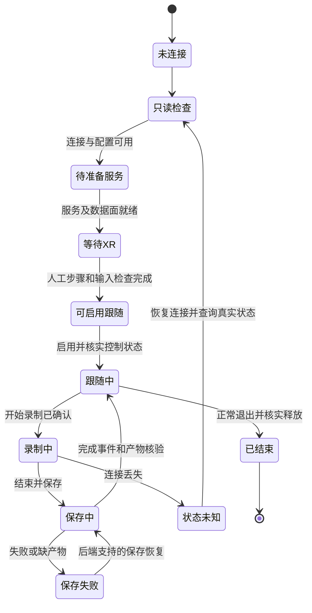

# 数据管线工作台：交互逻辑与界面设计

版本：方案 v1，2026-10-26。配套[整体方案](10_整体方案与产品价值_2026-10-26.md)。本文与[可点击原型](../design/workbench_prototype/index.html)描述规划体验，不代表工作台 v0.1.2 已具备这些功能。

## 1. 使用场景与设计判断

使用者在明亮办公室或实验室，通过 Windows、macOS 或 Linux 笔记本组织一个机器人的数据与实验。界面采用浅色、石墨文字与少量深红操作强调。密度以能连续阅读表格、错误与日志为准，避免大面积装饰、蓝绿色、漂浮卡片墙和假实时指标。

交互借鉴“状态可见、符合用户语言、可退出、错误可恢复、减少记忆负担”等可用性原则，依据为 [NN/g 原始启发式](https://www.nngroup.com/articles/ten-usability-heuristics/)。本方案只做专家设计推演，尚未通过真实用户测试或信息架构树测试。

三项明确需求：单人单机器人；阶段按钮为主，可选择串联；目录用系统原生选择器。两种工作角色是行为视角而非权限：**整理者**取得/归档数据，**训练使用者**选数/实验，可以是同一个人。

## 2. 信息架构：任务是入口，资产可以跨任务复用

```text
任务选择与当前本体 / 本轮验收范围
├─ 任务总览：当前进展、阻断、下一步、最近结果
├─ 采集会话：设备准备、XR连接、跟随、录制、回合保存
├─ 数据资产：来源登记、导入/获取、筛选、档案、回合视图
├─ 准备训练数据：适用性、质量、切段、增强、转换、读取验收
├─ 训练与评估：配方、执行机、运行、闭环结果和视频
├─ 部署与回流：部署匹配、实机记录、失败样本与补采待办
└─ 运行记录：各阶段作业、输入输出、日志、取消和恢复

设备与模板：设备/遥操作档案、来源读取器、配方、执行机、工作区
```

任务页显示当前选中的数据视图和模型，不把所有库内数据都塞入流程。全局资产库可从当前任务进入或移出；进入任务只是添加引用，不复制所有文件。设备与模板作为低频设置入口，日常用户不必反复打开。

导航以完成目标命名。`EpisodeWriter`、DDS域、`repo_id` 等仅在高级配置或错误详情出现；不能将终端窗口、Python模块或数据库表当成用户主导航。

## 3. 三条核心用户旅程

### 3.1 第一次采集与以后重复使用

| 使用者动作 | 系统展示/承担 | 失败或未知时 |
| --- | --- | --- |
| 建任务，确认本轮范围 | 分别保存总目标、当前验收范围、成功判据、本体/手型/相机 | 可保存草稿；关键配置未核实不放行控制准备 |
| 选择设备档案，运行只读预检 | 按 Host、PC2、XR、基础运控显示检查项、时间与下一步 | 显示失败设备和检查依据，不靠主进程 PID 判就绪 |
| 准备服务 | 复用兼容基础服务，只启动缺失且可管理的组件 | 留下已成功项，重试失败项；不重启整套机器人栈 |
| 到头显进入 XR | 显示访问入口、二维码候选及人工待办、追踪是否新鲜 | 未进入会话时保持“等待头显”，允许返回检查网络/证书 |
| 启用遥操作跟随 | 显示将启用的控制模式和范围，核实真实状态 | 状态不明时显示未知，不把“发送成功”写成“控制就绪” |
| 开始录制，结束并保存 | 时长、回合标识、图像/状态新鲜度，保存中与完成分开 | 未完成回合隔离；保存失败后提供重试保存/保留现场，不自动开始下个回合 |
| 标记结果，进入检查 | 记录成功/失败/未标注，登记已完成回合与来源 | 失败回合也可保留研究用途，不默认删除 |
| 下次采集 | 提议复用上次档案，只检查变化项与现场必需项 | 硬件/SDK/相机变化标为需复查，不永久缓存为“兼容” |

没有真机时仅进入明确标记的模拟适配器流程。模拟状态不与真机历史混在同一成功统计中。

### 3.2 外部数据：先看是否值得拿，再决定拿多少

1. 选“登记外部来源”，粘贴 Hub ID/链接，或选择本地交付目录。系统建议来源名称、版本、归档位置，保留来源原文。
2. 显示来源声明和已读取字段：任务、本体、模态、动作说明、格式/版本、许可/交付条件。未读取的内容显示未知，标签建议不能悄悄成为事实。
3. 用户可只登记，也可先取样。下载前选择 revision、文件/回合范围、目的地和执行机，显示已知大小或“待估算”。不默认全量下载。
4. 本地交付先读清单和少量样本，核对缺文件/坏包/语义；大体量复制改为增量清单任务。原始资产不被覆盖。
5. 用户只确认关键字段，其余由读取器提取：来源/版本、原始任务、本体、用途条件、持有范围。来源任务不默认填写为目标任务。
6. 列表区分仅登记、样本、部分、所选范围完整及在线/离线。整理者可补充备注；训练使用者保存选定回合视图。
7. 在当前任务和配方下查看适用性，决定复用、运行已有适配、补材料或放弃。已是目标格式且检查通过的可复用，不再强制转换。

采购场景额外保存交付批次、样本报告和差异清单，支持导出给供应商核对。平台不代替合同判断或自动购买；现成采购先小样，定制先试采再批量交付。

### 3.3 使用数据：先验收输入，再投入训练

选数据视图与配方后先显示差异，例如“相机名称可映射”“动作单位待核实”“控制范围不足”“缺时间/标定”。用户选择已有适配模板，看到将改变的字段、信息损失和预计产物后执行。切段/增强为可选步骤，先划分再派生，保留母回合。

成功产物进入训练读取检查，实际调用目标后端加载样本、验证形状/模态/动作语义约束与统计来源。通过后才开放该组合的训练操作。训练执行机、数据同步范围、配置快照与运行预算均可见。

训练结束只显示模型产物，闭环评估另启动，输出固定场景下的成功/失败、视频和日志。部署又是一项独立操作，需要动作解释器与设备/运行时匹配。失败案例可转为“补采桌B放置样本”等待办，关联原实验，而非只回到一串日志。

## 4. 页面设计与默认动作

| 页面 | 首屏要回答的问题 | 主要布局 | 主操作与次操作 |
| --- | --- | --- | --- |
| 任务总览 | 当前卡在哪里，下一步做什么 | 顶部任务/范围，横向阶段线，中间阻断原因与输入输出，下方最近结果 | 当前可执行的下一步；查看全流程、改任务、打开历史 |
| 采集会话 | 哪个设备准备好了，现在能录吗 | 左：设备分组检查与人工待办；中：实际预览；下：回合与录制状态 | 随当前状态切换为检查/准备/等待XR/启用跟随/开始录制/结束并保存；结束会话单独放置 |
| 数据资产 | 我有什么、来自哪里、这次能否使用 | 可搜索/筛选表格，右侧选中档案；回合详情单独展开 | 登记/导入、添加到任务视图；检查适用性、补字段、查看原始文件 |
| 准备训练数据 | 要处理哪些差异，处理后给谁使用 | 上：固定数据视图/目标/配方；中：差异与处置表；下：变换预览和产物 | 检查适用性、运行所选适配、训练读取检查；按需切段/增强 |
| 训练与评估 | 在哪里运行，输入是什么，结果怎样 | 配方摘要、执行位置/预算、运行进展、结果表和视频 | 启动训练；评估、取消、复制为新实验、查看完整配置 |
| 部署与回流 | 哪个模型配哪台设备，验收范围是什么 | 模型/控制/设备匹配清单，动作范围、现场记录、回流待办 | 生成部署包，进入现场启用步骤；正常结束、打开回退说明 |
| 运行记录 | 哪一步失败、还能复用什么 | 作业列表和所选详情，时间线、错误、输入输出、日志折叠区 | 重试失败步骤、继续下游、下载报告；取消当前作业 |

全页只突出一个当前主操作。多阶段不代表多个同等强度按钮排满首屏。未来功能可以在方案原型中预览，但正式工作台只有实际接入的后端才提供执行入口。

### 总览阶段线的含义

阶段线显示数据取得、检查整理、准备输入、训练、评估、部署。它是可导航的状态概览，不强制每份外部数据从头重做。当前阶段选中、已验证、有警告、等待人工、未接入均有文字；颜色只作辅助。点击阶段打开该阶段的输入、输出、条件与历史。

## 5. 状态模型：区分文件、适用性与实验结论

| 对象 | 状态维度 | 不能混淆的结论 |
| --- | --- | --- |
| 来源条目 | 仅登记、获取中、已持有范围、离线/未知 | 登记网址不等于本地有数据 |
| 原始回合 | 录制中、保存中、保存完成、保存失败、异常待核对 | 出现data.json不等于保存完成 |
| 质量 | 各检查项的通过/警告/错误/未检查，另有人工任务标注 | 结构通过不等于时序、标定、任务成功均通过 |
| 当前组合适用性 | 未评估、条件满足、有已支持适配、缺材料、需新增适配 | 任务标签相关不等于配方可训练 |
| 作业 | 排队、预检、等待人工、运行、停止中、成功、失败、取消、中断/未知 | 请求ACK、进程存活不等于业务完成 |
| 模型证据 | 读取通过、训练完成、仿真闭环验证、指定范围实机验证 | 任意前一项不能替代后一项 |

适用性绑定“数据版本/视图 + 本体配置 + 配方/读取器 + 用途 + 适配配置”。不能在资产全局放一个永不过期的`training_ready=true`。关键字段改变时显示需复查，历史记录仍保留。

### 采集控制状态



上图为拟实现契约。XR断流等任一步骤可以失败；实际停止行为由 Host 适配器与厂商控制器实现，不能依赖网页在线。`CMD_RECORD_TOGGLE` 不可盲目重试，桥接层必须核实目标状态。停止录制、退出遥操作和硬件急停不用同一个按钮名称。

## 6. 按钮、串联与异常恢复契约

每个动作固定显示：动作名称、执行位置、输入、前提、实际输出，以及失败后的下一步。按钮禁用时旁边说明缺什么并提供修复入口，不把原因只放在鼠标悬浮提示中。

| 场景 | 界面反馈 | 恢复动作 |
| --- | --- | --- |
| 设备未连/SDK不匹配 | 对应设备行注明错误与最后检查时间 | 改档案/检查网络后仅重试该项 |
| 头显未进入会话 | 等待人工，并保留Host/PC2就绪状态 | 在头显处理；网页可继续看诊断 |
| 控制请求答复丢失 | 状态未知，停止新的控制指令提交 | 重连查询真实状态，不自动重发toggle |
| 保存失败/空间不足 | 当前回合隔离，列出已保存与缺失产物 | 清理/更换目的地后的受支持恢复，或保留未完成现场 |
| 下载断开/限额 | 当前已持有范围、失败文件与可恢复能力 | 后端支持时续传并核验哈希，不重新下载成功文件 |
| 动作单位未知 | 允许保留资产，当前训练准备被阻断 | 补交付说明，或使用有证据的读取/转换模板 |
| 格式已可用 | 显示已通过读取与版本匹配的证据 | 直接复用产物，不强制再转一次 |
| 转换/训练worker退出 | 错误阶段、日志、配置和已成功产物可见 | 复制修订配置或重试该阶段，不自动覆盖旧结果 |
| 页面刷新/关闭 | 后端作业仍可恢复查看，表单草稿可保留 | 回到同一任务和所选作业；显示状态最后更新时间 |
| 切换资产/作业 | 立即隐藏旧详情，显示新对象加载状态 | 只接受当前对象的返回结果，避免串数据 |

自动串联采用“运行已选步骤到仿真评价”等明确终点。启动前列出将运行/复用/等待的步骤和执行位置；失败停止下游，人工节点等待。恢复先核对输入是否变化，再复用成功产物。首次控制启用、未准备的XR会话和现场部署不被自动跳过。

## 7. 表单与跨平台路径

- 首次任务表单只要求名称、总目标、本轮范围和已支持本体；配方可稍后选。模板中可编辑高级参数，但没有必要每天重填全部参数。
- 本机路径提供原生文件/目录选择器与手动输入。相对路径保存于受管理工作区，用户看到实际位置及执行机。
- 远程执行机的路径由受限执行器校验/列目录或使用已登记存储位置，明确标为远程；不能打开Windows本地选择器假装挑到了Linux服务器路径。
- 工作区切换需要先检查活动作业，不作为随手可编辑文本框。凭据单独配置，日志/模板/演示包不包含密钥。
- 元数据自动建议后显示来源和待确认项；目标任务、原始数据任务、源本体、目标本体分别命名，禁止隐式覆盖。
- 错误就地显示，输入与所选文件保留。取消不改原路径，不自动入库。

## 8. 视觉与组件规范

| 项目 | 设计取舍 |
| --- | --- |
| 色彩 | 浅灰画布、近白内容、石墨正文；深红用于主要操作和当前项，蓝用于链接，成功/警告/失败均配文字 |
| 字体 | 系统无衬线，中文用系统字体回退；正文14–16px，辅助不低于12px，标题24–28px，日志等宽 |
| 布局 | 桌面侧栏约208px、主体最大1280px；表格和分隔线优先，避免嵌套卡片；长日志与细节渐进展开 |
| 控件 | 原生输入、下拉、复选框；按钮统一高度/焦点/加载反馈；图标仅辅助熟悉操作，必要操作有文字 |
| 密度 | 主要信息在首屏，包括任务范围、当前阻断、输入输出和主按钮；复杂schema、全部参数、原始日志放展开区 |
| 响应 | 桌面并列，窄屏上下排列；大表格容器内横向滚动，关键操作可达；不将手机操作机器人作为首期目标 |
| 可访问性 | 键盘可达、可见焦点、语义标题/表格、实时状态文本；正常正文对比至少4.5:1；减少运动时关闭过渡 |
| 动效 | 150–200ms颜色/展开反馈，不做装饰动画；有真实进度显示真实进度，无法估计就展示阶段与已处理量 |

PPT仍沿用红色标题、简洁浅色、底部公司页脚留白。产品页面中的普通标题不必全红；界面的主操作色与报告标题色区分用途。

## 9. 原型交付与后续验证

原型是独立离线 HTML/CSS/JavaScript，演示任务总览、采集状态、外部数据筛选/档案、训练准备差异、实验/部署和运行记录。所有设备、数据和结果都标明示例，不调用SDK、下载、训练或部署。刷新可重置演示，不写正式工作区。

原型至少覆盖：正常录制/保存、保存失败恢复、外部来源资料缺失、已支持适配后读取通过，以及查看失败作业。纯界面演示不能当作功能验收。

下一步邀请5名代表用户操作：重复采集、找到外部样本并解释阻断、定位保存失败并恢复。观察是否能独立完成、在哪一步求助、是否误认数据已可训练；据结果调整信息架构、文案和按钮布局。正式产品接入后再做Windows/macOS/Linux原生交互与执行机联调验收。
